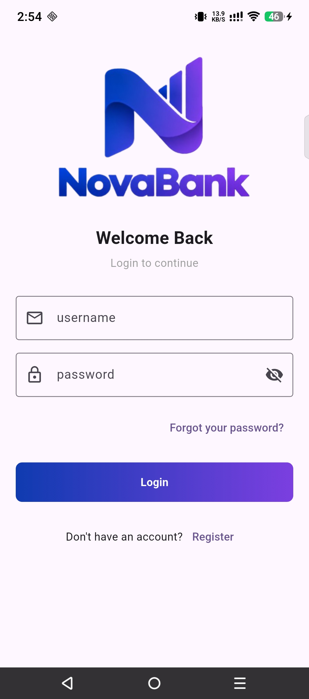
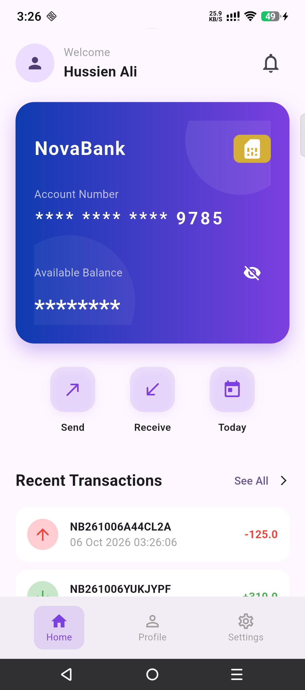
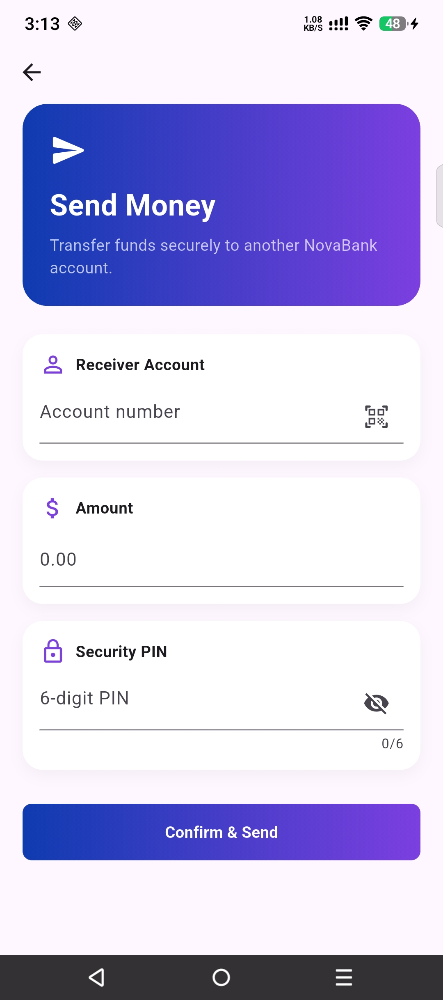
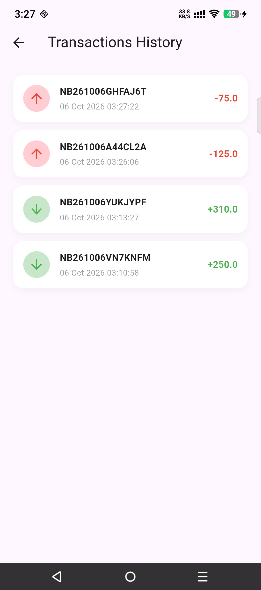

# NovaBank Mobile

The Flutter mobile client for **NovaBank**, a financial system built with a Spring Boot microservices backend. Users can register, manage their account, and send and receive money between accounts on the same system.

> **Note:** NovaBank is an educational / portfolio project. It is not intended for real financial use.

Backend repository: [Financial-system-Backend](https://github.com/NaelEbrahim/Financial-system-Backend)

## Features

* User registration with email OTP verification
* Login with JWT access and refresh tokens
* Forgot password and password reset
* User profile management
* Account balance overview
* Send money to another account using the receiver's wallet key
* Receive money
* Transaction PIN verification for transfers
* Transaction history
* Daily transaction totals
* In-app notifications
* Mark notifications as read
* Delete notifications
* Update password
* Update email
* Secure token storage

## Screenshots

Add screenshots to the `screenshots/` folder and link them here.

| Login                           | Home                          | Send Money                                | Transaction History                             |
| ------------------------------- | ----------------------------- | ----------------------------------------- | ----------------------------------------------- |
|  |  |  |  |

## Tech Stack

* Flutter
* Dart
* Dio (HTTP client)
* BLoC / Cubit (state management)
* Flutter Secure Storage

## Architecture

The app communicates with the backend **API Gateway**, which validates JWT tokens and routes requests to the appropriate microservices.

```text
Flutter App
     |
     v
API Gateway
     |
     +----> Identity Service
     |
     +----> Account Service
     |
     +----> Transaction Service
     |
     +----> Notification Service
```

### State Management

The application uses a centralized `Manager` and state classes to manage application state.

```text
Flutter Screens
       |
       v
    Manager
       |
       v
    States
       |
       v
  DioHelper
       |
       v
 API Gateway
```

The `Manager` handles application operations and emits states that are consumed by the UI.

### Authentication Flow

```text
Login
  |
  v
Identity Service
  |
  +--> Access Token
  +--> Refresh Token
          |
          v
     Flutter App
          |
          +--> Secure Storage
          |
          +--> Dio Interceptor
                    |
                    +--> Adds access token
                    |
                    +--> Refreshes token on 401
```

## Getting Started

### Prerequisites

* Flutter SDK (stable channel)
* Android Studio or VS Code with the Flutter plugin
* An Android emulator, iOS simulator, or physical device
* NovaBank backend running locally

### 1. Clone the repository

```bash
git clone https://github.com/NaelEbrahim/Financial-system-Mobile.git
cd Financial-system-Mobile
```

### 2. Install dependencies

```bash
flutter pub get
```

### 3. Configure the API Base URL

Configure the backend API Gateway URL in:

```text
lib/shared/Constants.dart
```

For example:

```dart
const String baseUrl = 'http://10.0.2.2:8222';
```

Use the appropriate address for your environment:

| Environment      | Base URL                             |
| ---------------- | ------------------------------------ |
| Android emulator | `http://10.0.2.2:8222`               |
| iOS simulator    | `http://localhost:8222`              |
| Physical device  | `http://<your-computer-LAN-IP>:8222` |

> `10.0.2.2` allows an Android emulator to access the host machine's `localhost`.

### 4. Run the application

```bash
flutter run
```

## Project Structure

```text
NovaBank-Mobile/
│
├── assets/
│   ├── sounds
│   |   └── qr_beep.mp3
│   ├── logo.png
│
├── lib/
│   │
│   ├── bloc/
│   │   ├── Manager.dart
│   │   └── States.dart
│   │
│   ├── models/
│   │   ├── AccountInfoModel.dart
│   │   ├── DailyTotalsModel.dart
│   │   ├── LoginModel.dart
│   │   ├── NotificationModel.dart
│   │   ├── ProfileModel.dart
│   │   └── TransactionModel.dart
│   │
│   ├── modules/
│   │   ├── Auth/
│   │   │   ├── ForgotPassword.dart
│   │   │   ├── Login.dart
│   │   │   ├── Register.dart
│   │   │   ├── Register_2.dart
│   │   │   ├── ResetForgotPassword.dart
│   │   │   └── VerifyEmail.dart
│   │   │
│   │   ├── Base.dart
│   │   ├── DailyTotals.dart
│   │   ├── Home.dart
│   │   ├── Notifications.dart
│   │   ├── Profile.dart
│   │   ├── ReceiveMoney.dart
│   │   ├── SendMoney.dart
│   │   ├── Settings.dart
│   │   ├── Splash.dart
│   │   ├── TransactionsHistory.dart
│   │   ├── TransferRequested.dart
│   │   ├── UpdateEmail.dart
│   │   ├── UpdateEmail_2.dart
│   │   └── UpdatePassword.dart
│   │
│   ├── remote/
│   │   ├── DioHelper.dart
│   │   ├── Interceptor.dart
│   │   └── Routes.dart
│   │
│   ├── shared/
│   │   ├── Constants.dart
│   │   ├── Reusable.dart
│   │   └── SecureStorage.dart
│   │
│   └── main.dart
│
├── pubspec.yaml
├── README.md
└── .gitignore
```

### Folder Responsibilities

| Folder          | Responsibility                                               |
| --------------- | ------------------------------------------------------------ |
| `bloc/`         | Application state management and business operations         |
| `models/`       | API response and application data models                     |
| `modules/`      | Application screens and user-facing features                 |
| `modules/Auth/` | Registration, login, OTP verification, and password recovery |
| `remote/`       | API communication, routes, and authentication interceptor    |
| `shared/`       | Constants, reusable components, and secure storage           |
| `main.dart`     | Application entry point                                      |

## Authentication

NovaBank Mobile uses JWT-based authentication with access and refresh tokens.

Authentication-related functionality includes:

* Login
* Registration
* Email OTP verification
* Forgot password
* Reset password
* Update password
* Update email
* Token refresh
* Secure token storage

The `Interceptor.dart` handles authentication headers and token refresh when an access token expires.

`SecureStorage.dart` is used to securely store authentication credentials on the device.

## Money Transfer

Users can send money using:

* Receiver wallet key
* Transfer amount
* Transaction PIN

```text
Send Money
     |
     v
Receiver Wallet Key
     |
     v
Amount
     |
     v
Transaction PIN
     |
     v
Confirm Transfer
     |
     v
Transfer Requested
     |
     v
Transaction Processing
```

A transfer may initially remain **PENDING** while the backend processes the request asynchronously.

## Transaction History

The transaction history screen supports:

* Incoming transactions
* Outgoing transactions
* Transaction reference numbers
* Transaction dates
* Transaction amounts
* Pagination
* Pull-to-refresh
* Loading indicators

Daily transaction totals are also displayed through the `DailyTotals` module.

## Notifications

The application provides in-app notifications for account activity.

Users can:

* View notifications
* Mark notifications as read
* Delete notifications
* Refresh notifications

Notification data is represented by `NotificationModel.dart`.

## Backend Setup

The mobile application requires the NovaBank backend to be running.

Follow the setup instructions in the [backend repository](https://github.com/NaelEbrahim/Financial-system-Backend).

The backend requires:

1. Docker infrastructure
2. Config Server
3. Discovery Service
4. Identity Service
5. Account Service
6. Transaction Service
7. Notification Service
8. API Gateway

For local email verification, OTP emails can be viewed through **MailDev**.

## Configuration & Security

Sensitive files and credentials should never be committed to the repository.

Keep the following files local when applicable:

* `.env` files
* `android/key.properties`
* Android keystore files (`*.jks`, `*.keystore`)
* `google-services.json`
* `GoogleService-Info.plist`

Authentication tokens are stored using secure device storage.

## Development

Run tests:

```bash
flutter test
```

Analyze the code:

```bash
flutter analyze
```

Format the code:

```bash
dart format .
```

Build an Android APK:

```bash
flutter build apk
```

## Project Status

NovaBank Mobile is an ongoing **software engineering portfolio project** focused on:

* Flutter mobile development
* BLoC / Cubit state management
* REST API integration with Dio
* JWT authentication and token refresh
* Secure local storage
* Form validation
* Pagination
* Pull-to-refresh
* Microservices integration

## License

This project is licensed under the **MIT License**.

See the [LICENSE](LICENSE) file for details.
